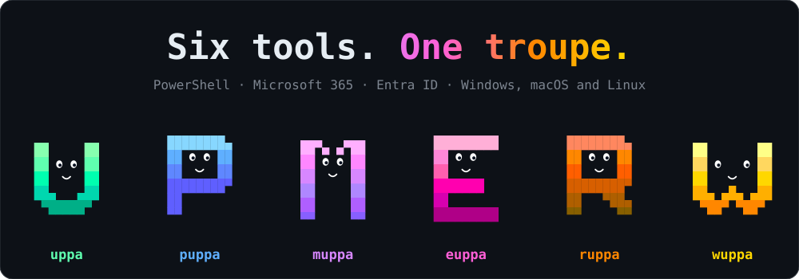

<h1 align="center">André Gaudet 👋</h1>

  <b>Building tools for Microsoft 365, PowerShell and automation.</b>

  

<h3 align="center">👀 <a href="https://truppa.vercel.app">Truppa</a></h3>

  <a href="https://github.com/pipebreak33/uppa">Uppa</a> ·
  <a href="https://github.com/pipebreak33/puppa">Puppa</a> ·
  <a href="https://github.com/pipebreak33/muppa">Muppa</a> ·
  <a href="https://github.com/pipebreak33/euppa">Euppa</a> ·
  <a href="https://github.com/pipebreak33/ruppa">Ruppa</a> ·
  <a href="https://github.com/pipebreak33/wuppa">Wuppa</a> 
  A family of small CLI tools built to solve everyday IT problems.

  ⚙️ PowerShell · Microsoft 365 · Graph · APIs · Docker · MCP

  
  
  
  
  
  
  
  

  <i>Build useful things. Automate the rest.</i>

